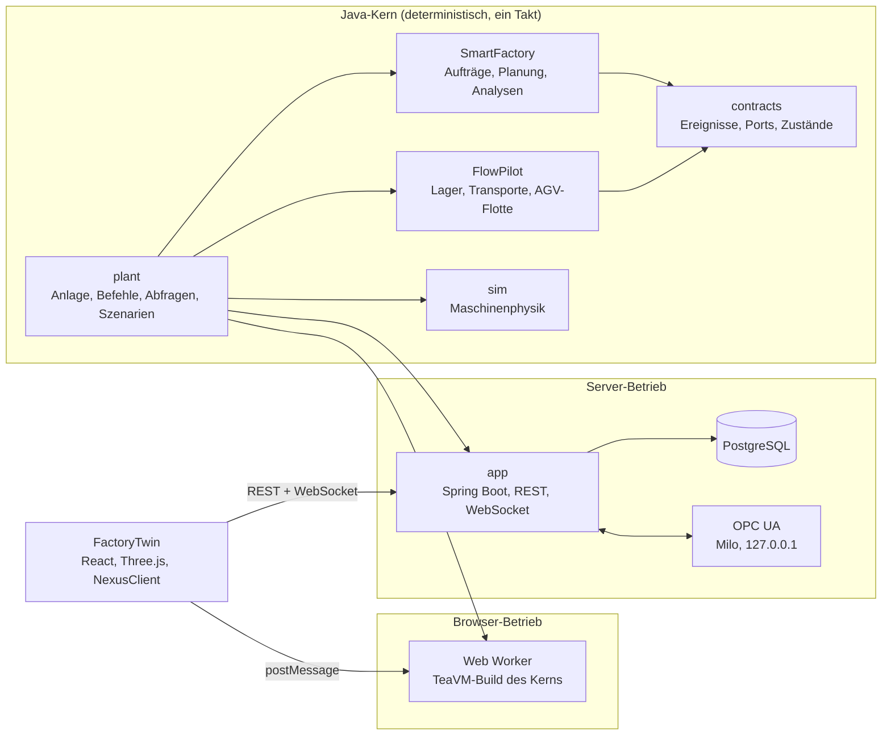

# NEXUS Industrial OS

Eine kleine Fertigung als Software: Aufträge, Planung, Maschinen, Lager und fahrerlose Transportfahrzeuge in einem Java-Kern, dazu eine 3D-Oberfläche. Derselbe Kern läuft auf dem Server (Spring Boot, PostgreSQL, OPC UA) und im Browser (TeaVM im Web Worker) und liefert bei gleichem Seed dieselbe Ereignisfolge.

## Architektur



Ein Objekt hat genau eine zuständige Stelle: SmartFactory für Aufträge und Maschinenzustände, FlowPilot für Material, Transporte und Fahrzeuge, die Simulation für die Physik der Anlage. Auf dem Server laufen alle Rückmeldungen der Maschinen über OPC UA. Die Oberfläche spricht mit beiden Laufzeiten über dieselbe Schnittstelle `NexusClient` und dasselbe JSON.

## Starten

| Betriebsart | Befehl | Was läuft |
|---|---|---|
| Browser | `cd FactoryTwin && npm install && npm run core && npm run dev` | Kern im Web Worker, keine weiteren Dienste |
| Server | `cd FactoryTwin && node scripts/run-server.mjs`, dann `npm run dev -- --mode server --port 5179` | Spring Boot mit eingebetteter PostgreSQL und OPC UA |
| Docker Compose | `docker compose up --build` | PostgreSQL, Server und Oberfläche auf `http://localhost:8080` |
| Online | GitHub Pages (Browser-Modus) | wie Browser, ohne Installation |

Voraussetzungen: Java 25 und Node 24. Docker nur für Compose.

## Tests

| Ebene | Befehl |
|---|---|
| Kern, Server, TeaVM-Gleichlauf | `./mvnw -B verify` |
| Oberfläche | `cd FactoryTwin && npx vitest run && npx tsc -b --noEmit` |
| Ende zu Ende, Browser | `cd FactoryTwin && npm run e2e` |
| Ende zu Ende, Server | `cd FactoryTwin && npm run e2e:server` |

GitHub Actions führt alle vier aus, dazu einen Lauf von Docker Compose (`.github/workflows/ci.yml`).

## Sicherheit

Die API hat keine Anmeldung und keine Benutzerkonten. Sie ist für den lokalen Betrieb und die Vorführung gedacht und darf so nicht offen ins Internet gestellt werden. Der Server bedient nur `localhost` und die Hosts in `nexus.allowed-hosts` und nimmt Befehle nur von den Origins in `nexus.ws.allowed-origins` an. Der OPC-UA-Server hört nur auf `127.0.0.1`.

## Aufbau

```
platform/   contracts, sim, plant, web (TeaVM), app (Spring Boot)
SmartFactory/, FlowPilot/   die beiden Fachmodule des Kerns
FactoryTwin/   die Oberfläche (eigene README mit Bereichen, Szenarien und Tests)
docker/, compose.yaml   Images und Compose für den Server-Betrieb
docs/superpowers/   Spezifikation und Umsetzungspläne
```
