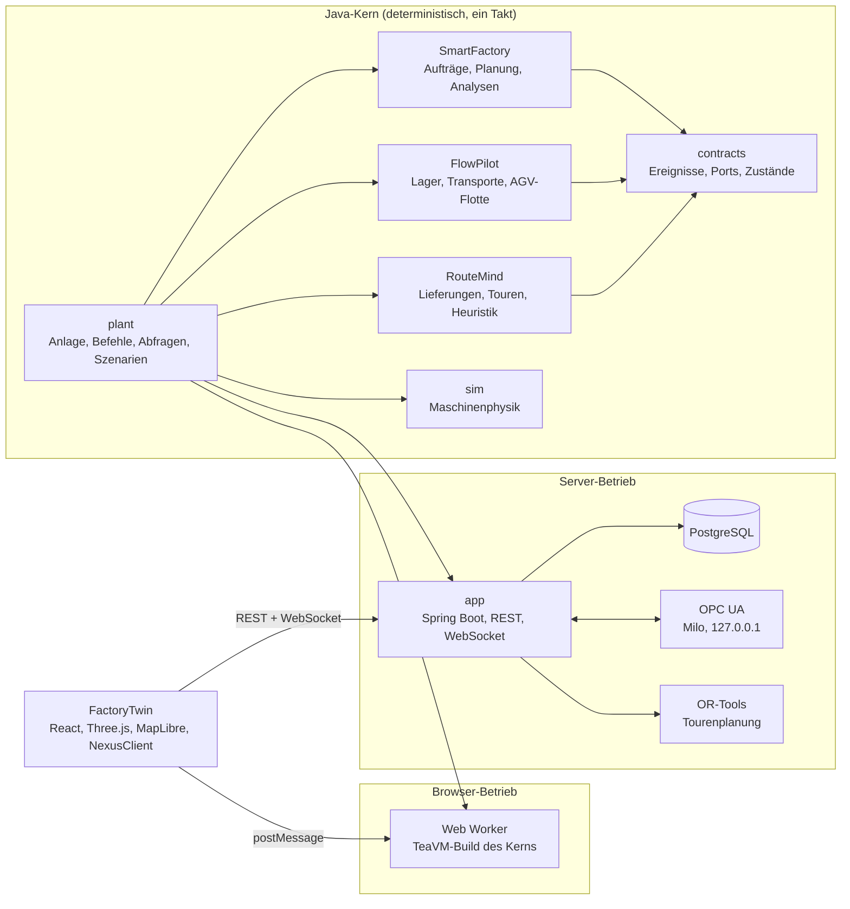

# NEXUS Industrial OS

Eine kleine Fertigung als Software: Aufträge, Planung, Maschinen, Lager, fahrerlose Transportfahrzeuge und die Auslieferung an Kunden in einem Java-Kern, dazu eine 3D-Oberfläche. Derselbe Kern läuft auf dem Server (Spring Boot, PostgreSQL, OPC UA) und im Browser (TeaVM im Web Worker) und liefert bei gleichem Seed dieselbe Ereignisfolge.

## Architektur



Ein Objekt hat genau eine zuständige Stelle: SmartFactory für Aufträge und Maschinenzustände, FlowPilot für Material, Transporte und Fahrzeuge in der Halle, RouteMind für Lieferungen, Lieferfahrzeuge und Touren, die Simulation für die Physik der Anlage. Auf dem Server laufen alle Rückmeldungen der Maschinen über OPC UA. Die Oberfläche spricht mit beiden Laufzeiten über dieselbe Schnittstelle `NexusClient` und dasselbe JSON.

## RouteMind

RouteMind liefert die Fertigware an 30 Kunden in Zürich und Umgebung. Ist ein Auftrag eingelagert, reserviert RouteMind die Ware und lässt sie von einem AGV zur Verladezone `LZ-1` bringen. Touren fahren in Wellen alle 30 Minuten Simulationszeit zwischen 06:00 und 22:00; eine Tour startet erst, wenn ihre ganze Ware verladen ist. Pannen unterwegs (zufällig aus dem Seed oder ausgelöst) unterbrechen die Tour, offene Lieferungen werden höchstens zweimal neu versucht.

Geplant wird hinter dem Port `RouteOptimizer`: im Browser mit einer Heuristik (Savings, 2-opt, Verschieben), auf dem Server mit Google OR-Tools (`nexus.routemind.solver=ortools`, mit `heuristic` plant der Server wie der Browser). Jede Planung zeigt den einfachen Ausgangsplan (nächster Nachbar) neben dem optimierten Plan.

Die Fahrzeiten, Strecken und Strassenverläufe sind ein fester Satz: `RouteMind/roads/places.json` nennt die Orte, `node FactoryTwin/scripts/build-roads.mjs` fragt einmalig den öffentlichen OSRM-Demodienst (rund neun Minuten) und schreibt `RoadData.java` und `FactoryTwin/public/routemind/roads.json`. Zur Laufzeit wird kein Routingdienst gefragt.

Quellen: Strassendaten © OpenStreetMap-Mitwirkende (ODbL), Routen berechnet mit OSRM. Die Kartenkacheln lädt die Oberfläche zur Laufzeit von tile.openstreetmap.org; die Karte braucht dafür eine Internetverbindung.

## Starten

| Betriebsart | Befehl | Was läuft |
|---|---|---|
| Browser | `cd FactoryTwin && npm install && npm run core && npm run dev` | Kern im Web Worker, keine weiteren Dienste |
| Server | `cd FactoryTwin && node scripts/run-server.mjs`, dann `npm run dev -- --mode server --port 5179` | Spring Boot mit eingebetteter PostgreSQL und OPC UA |
| Docker Compose | `docker compose up --build` | PostgreSQL, Server und Oberfläche auf `http://localhost:8080` |
| Online | GitHub Pages (Browser-Modus) | wie Browser, ohne Installation |

Voraussetzungen: Java 25 und Node 24. Docker nur für Compose.

## Tests

| Ebene | Befehl |
|---|---|
| Kern, Server, TeaVM-Gleichlauf | `./mvnw -B verify` |
| Oberfläche | `cd FactoryTwin && npx vitest run && npx tsc -b --noEmit` |
| Ende zu Ende, Browser | `cd FactoryTwin && npm run e2e` |
| Ende zu Ende, Server | `cd FactoryTwin && npm run e2e:server` |

GitHub Actions führt alle vier aus, dazu einen Lauf von Docker Compose (`.github/workflows/ci.yml`).

## Sicherheit

Die API hat keine Anmeldung und keine Benutzerkonten. Sie ist für den lokalen Betrieb und die Vorführung gedacht und darf so nicht offen ins Internet gestellt werden. Der Server bedient nur `localhost` und die Hosts in `nexus.allowed-hosts`. Befehle nimmt er von seiner eigenen Seite, von den Origins in `nexus.ws.allowed-origins` und von Anfragen ohne Origin an (curl, Programme auf demselben Rechner); Browser senden bei fremden Seiten immer einen Origin. Docker Compose bindet die Oberfläche deshalb nur an `127.0.0.1`, nicht ans lokale Netz. Der OPC-UA-Server hört nur auf `127.0.0.1`.

## Aufbau

```
platform/   contracts, sim, plant, web (TeaVM), app (Spring Boot)
SmartFactory/, FlowPilot/, RouteMind/   die drei Fachmodule des Kerns
FactoryTwin/   die Oberfläche (eigene README mit Bereichen, Szenarien und Tests)
docker/, compose.yaml   Images und Compose für den Server-Betrieb
docs/superpowers/   Spezifikation und Umsetzungspläne
```
