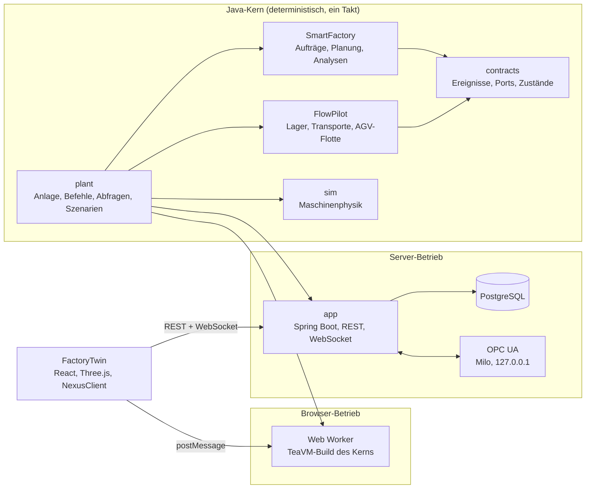

# M3-B Betrieb: CI, Docker Compose, GitHub Pages, README – Implementation Plan

> **For agentic workers:** REQUIRED SUB-SKILL: Use superpowers:subagent-driven-development (recommended) or superpowers:executing-plans to implement this plan task-by-task. Steps use checkbox (`- [ ]`) syntax for tracking.

**Goal:** NEXUS lässt sich ohne lokale Einrichtung prüfen, betreiben und zeigen. GitHub Actions baut und testet Backend und Frontend und führt Playwright in beiden Betriebsarten aus. Docker Compose startet Server, PostgreSQL und Oberfläche. GitHub Pages veröffentlicht den Browser-Modus. Eine README im Wurzelverzeichnis erklärt das Ganze mit einem Architekturdiagramm.

**Architecture:** Zwei Workflows unter `.github/workflows/`:
- `ci.yml`: Jobs `backend`, `frontend`, `e2e` und `compose`.
- `pages.yml`: baut den Browser-Modus und veröffentlicht ihn.

Docker:
- `docker/app.Dockerfile` baut das Spring-Boot-Jar.
- `docker/web.Dockerfile` baut den TeaVM-Kern und die Oberfläche im Server-Modus und liefert sie über nginx aus. nginx leitet `/api` und `/ws` an den Server weiter.
- `compose.yaml` verbindet `db` (PostgreSQL 18), `app` und `web`.

Die Workflows rufen dieselben Befehle auf, die lokal schon laufen (`./mvnw -B verify`, `npm run core`, `npm run e2e`, `npm run e2e:server`). Nichts wird nur für CI erfunden.

**Tech Stack:** GitHub Actions (`actions/checkout@v4`, `actions/setup-java@v4` mit Temurin 25, `actions/setup-node@v4` mit Node 24, `actions/upload-pages-artifact@v3`, `actions/deploy-pages@v4`, `actions/upload-artifact@v4`), Docker Compose, `eclipse-temurin:25`, `node:24`, `nginx:1.27-alpine`, `postgres:18-alpine`, Mermaid in Markdown.

**Spec:** `docs/superpowers/specs/2026-11-10-nexus-industrial-os-design.md` (Revision 3), Abschnitt 2a (TeaVM-Build in CI), 13 (PostgreSQL), 14 (GitHub Pages im Modus `browser`), 16 (README: keine Anmeldung, nicht offen ins Internet), 17 (CI: Backend-Build und Tests, Frontend-Typecheck, Tests und Build, Playwright gegen das gestartete Backend), 18 (M3), 20 (Docker Compose nur in CI prüfbar). Voraussetzung: M3-A ist gemergt (`e7c2382`).

**Form:** wie M3-A: vollständige Dateien, vollständige Befehle zur lokalen Prüfung.

## Was lokal geprüft werden kann und was nicht

Auf dem Entwicklungsrechner gibt es weder Docker noch die GitHub-CLI, und das Repository hat noch keinen Remote. Darum gilt:

- **Lokal geprüft:**
  - Die Workflows und `compose.yaml` sind gültiges YAML (`npx --yes js-yaml`).
  - Jeder Befehl, den ein Job ausführt, läuft hier in derselben Reihenfolge.
  - Der Server startet mit dem Compose-Profil gegen eine echte PostgreSQL.
  - Der Pages-Build läuft unter einem Unterpfad.
  - Das Architekturdiagramm rendert.
- **Erst nach dem Push geprüft:** die Workflows selbst, die Docker-Images und Compose (Spec 20) sowie die Pages-Veröffentlichung.

Anlegen des GitHub-Repositorys, Push und das Einschalten von Pages sind Schritte des Nutzers bzw. brauchen seine ausdrückliche Zustimmung (siehe „Übergabe“).

## Entscheidungen dieses Plans

- **`mvnw` wird in Git ausführbar** (`git update-index --chmod=+x mvnw`). Heute steht es mit Modus 100644 im Index; auf Linux-Runnern und im Docker-Build scheitert `./mvnw` sonst sofort. Zeilenenden sind über `.gitattributes` (`eol=lf`) schon richtig.
- **Kein Testcontainers, kein externer Dienst in CI:** Backend-Tests und `e2e:server` nutzen wie lokal die eingebettete PostgreSQL (Profil `embedded`). Compose ist der einzige Ort mit einer eigenständigen PostgreSQL.
- **Compose-Profil `compose`:** ein Spring-Profil ohne Einträge im Code. Es heisst nur, dass das Standardprofil `embedded` nicht aktiv ist und `NEXUS_DB_URL` zählt. Origin und Host setzt Compose als Startargumente (`--nexus.ws.allowed-origins=http://localhost:8080`, `--nexus.allowed-hosts=localhost`). So sind sie sichtbar und unabhängig von Spring-Umgebungsnamen.
- **Nur `web` ist von aussen erreichbar** (Port 8080 auf dem Rechner), `app` und `db` nur im Compose-Netz. nginx reicht `Host` durch, damit die Host-Prüfung des Servers `localhost` sieht.
- **Playwright in CI** nutzt das mitgelieferte Chromium (`npx playwright install --with-deps chromium`), lokal weiter den installierten Chrome. In CI startet Playwright seine Server immer selbst (`reuseExistingServer: !process.env.CI`).
- **Jeder E2E-Test prüft die Betriebsart:** Die Konfiguration mit Port 5179 erwartet „Server · verbunden“, die mit 5173 „Browser · verbunden“. Ein zufällig wiederverwendeter Server der falschen Art fällt sofort auf (Befund aus dem M3-A-Review).
- **Pages nur von `main`** und per Hand (`workflow_dispatch`). Der Build ist der Browser-Modus mit relativem `base: './'`, also unabhängig vom Repositorynamen im Pfad.
- **Architekturdiagramm als Mermaid** in `README.md`. GitHub rendert es direkt, keine Bilddatei zu pflegen.

## Global Constraints

- Spec 2a: der TeaVM-Build läuft in CI. Spec 17: „CI (GitHub Actions): Backend-Build und Tests, Frontend-Typecheck, Tests und Build, Playwright gegen das gestartete Backend.“
- Spec 14: GitHub Pages liefert den Build im Modus `browser`, alle Bedienelemente funktionieren.
- Spec 16: die README sagt ausdrücklich, dass die API keine Anmeldung hat und nicht offen ins Internet gestellt werden darf.
- Spec 20: Docker Compose wird nur in CI geprüft; die Oberfläche weist die Betriebsart aus.
- Keine Geheimnisse in Workflows, Images oder Compose. Das PostgreSQL-Passwort in Compose ist ein lokaler Demo-Wert und steht als solcher im Kommentar.
- Persönliche Angaben (Name, E-Mail) erscheinen nicht in Dateien, Workflows oder Commits ausser im vorhandenen Git-Autor.
- Commits enden mit `Co-Authored-By: Claude Opus 5.5 <noreply@anthropic.com>`. Nicht pushen.

## Review Focus

1. **Linux-Runner und Docker-Build:** `./mvnw` ohne Ausführungsrecht oder mit CRLF scheitert sofort. Erwartet: Modus 100755 im Index, LF im Checkout. Prüfung in Task 1 (`git ls-files -s mvnw`, `git check-attr eol mvnw`).
2. **Pages unter einem Unterpfad** (`https://<nutzer>.github.io/<repo>/`). Erwartet: Seite, Assets und Web Worker laden; die Anlage verbindet sich. Prüfung in Task 3: `dist` unter `/nexus/` ausliefern und mit Playwright öffnen.
3. **Compose hinter nginx:** WebSocket-Upgrade und Origin-Prüfung. Erwartet: `/api/v1/sim` antwortet, `/ws` antwortet mit 101. Prüfung im Compose-Job (Task 2), lokal das Profil `compose` gegen eine echte PostgreSQL.
4. **E2E gegen einen Server der falschen Art.** Erwartet: der Test schlägt mit klarem Text fehl, statt das Falsche zu bestehen. Prüfung in Task 1: absichtlich den Browser-Server auf 5179 starten und `e2e:server` laufen lassen.
5. **Langsame Runner:** Szenario E braucht bei 25× auf einem schwachen Runner länger. Erwartet: Zeitgrenzen der Jobs (`timeout-minutes`) über den Testzeiten, Artefakte bei Fehlschlag. Prüfung in Task 1 (Werte im Workflow).

---

### Task 1: CI-Workflow für Backend, Frontend und Playwright

**Files:**
- Modify: Git-Index von `mvnw` (Ausführungsrecht)
- Create: `.github/workflows/ci.yml`
- Modify: `FactoryTwin/playwright.config.ts`, `FactoryTwin/playwright.server.config.ts`, `FactoryTwin/e2e/scenarios.spec.ts`, `FactoryTwin/e2e/fps.spec.ts`

**Interfaces:**
- Produces: Jobs `backend`, `frontend`, `e2e` in `ci.yml`; Task 2 fügt `compose` an.

- [ ] **Step 1: Ausführungsrecht für `mvnw`**

Run: `git update-index --chmod=+x mvnw && git ls-files -s mvnw && git check-attr eol mvnw`
Expected: `100755 … mvnw` und `mvnw: eol: lf`.

- [ ] **Step 2: E2E-Test prüft die Betriebsart (rot zuerst)**

In `e2e/scenarios.spec.ts` ersetzt eine Hilfsfunktion den bisherigen regulären Ausdruck:

```ts
/** The runtime this configuration is meant to test: the server config talks to 5179, the browser config to 5173. */
function expectedMode(baseURL: string | undefined): 'Browser' | 'Server' {
  return baseURL?.includes(':5179') ? 'Server' : 'Browser';
}
```

`freshPlant` bekommt `baseURL` (`test(…, async ({ page, baseURL }) => …)`, Aufruf `await freshPlant(page, baseURL)`) und prüft

```ts
  await expect(page.getByText(`${expectedMode(baseURL)} · verbunden`), 'falsche Betriebsart: ein wiederverwendeter Server?').toBeVisible({
    timeout: 60_000,
  });
```

statt `page.getByText(/(Browser|Server) · verbunden/)`. In `e2e/fps.spec.ts` bleibt `Browser · verbunden` (es läuft nur im Browser-Modus).

Rot zeigen: im Browser-Modus einen Vite-Server auf 5179 starten (`npx vite --port 5179 --strictPort`, im Hintergrund) und `npx playwright test -c playwright.server.config.ts -g "Szenario D"` laufen lassen.
Expected: FAIL mit „falsche Betriebsart“. Danach den Vite-Server auf 5179 beenden. Vorher prüfen, dass auf 8080 kein Server läuft, sonst startet die Konfiguration keinen.

- [ ] **Step 3: Playwright startet in CI immer eigene Server**

In beiden Konfigurationen `reuseExistingServer: true` durch `reuseExistingServer: !process.env.CI` ersetzen (in `playwright.server.config.ts` bei beiden Einträgen).

- [ ] **Step 4: Workflow schreiben**

`.github/workflows/ci.yml`:

```yaml
# Spec 17: backend build and tests, frontend typecheck, tests and build, Playwright against the running backend.
name: CI

on:
  push:
    branches: [main]
  pull_request:
  workflow_dispatch:

permissions:
  contents: read

concurrency:
  group: ci-${{ github.ref }}
  cancel-in-progress: true

jobs:
  backend:
    name: Backend (Maven verify)
    runs-on: ubuntu-latest
    timeout-minutes: 30
    steps:
      - uses: actions/checkout@v4
      - uses: actions/setup-java@v4
        with:
          distribution: temurin
          java-version: '25'
          cache: maven
      - name: Build and test (embedded PostgreSQL, OPC UA, TeaVM, JVM/JS equivalence)
        run: ./mvnw -B verify

  frontend:
    name: Frontend (core, tests, typecheck, build)
    runs-on: ubuntu-latest
    timeout-minutes: 20
    defaults:
      run:
        working-directory: FactoryTwin
    steps:
      - uses: actions/checkout@v4
      - uses: actions/setup-java@v4
        with:
          distribution: temurin
          java-version: '25'
          cache: maven
      - uses: actions/setup-node@v4
        with:
          node-version: '24'
          cache: npm
          cache-dependency-path: FactoryTwin/package-lock.json
      - run: npm ci
      - name: Java core for the browser (TeaVM)
        run: npm run core
      - run: npx vitest run
      - run: npx tsc -b --noEmit
      - run: npx vite build

  e2e:
    name: Playwright (browser and server mode)
    runs-on: ubuntu-latest
    timeout-minutes: 45
    defaults:
      run:
        working-directory: FactoryTwin
    steps:
      - uses: actions/checkout@v4
      - uses: actions/setup-java@v4
        with:
          distribution: temurin
          java-version: '25'
          cache: maven
      - uses: actions/setup-node@v4
        with:
          node-version: '24'
          cache: npm
          cache-dependency-path: FactoryTwin/package-lock.json
      - run: npm ci
      - run: npx playwright install --with-deps chromium
      - run: npm run core
      - name: Browser mode (core in a web worker)
        run: npm run e2e
      - name: Server mode (Spring Boot, PostgreSQL, OPC UA)
        run: npm run e2e:server
      - name: Test results on failure
        if: failure()
        uses: actions/upload-artifact@v4
        with:
          name: playwright-results
          path: FactoryTwin/test-results
          retention-days: 7
```

- [ ] **Step 5: Prüfen**

Run: `npx --yes js-yaml .github/workflows/ci.yml > /dev/null && echo yaml ok`
Expected: `yaml ok`.

Die Befehle der Jobs lokal in derselben Reihenfolge (Git Bash, Wurzelverzeichnis; laufende `java`- und eingebettete `postgres`-Prozesse vorher beenden):
- `./mvnw -B verify` → Exitcode 0
- `cd FactoryTwin && npm ci && npm run core && npx vitest run && npx tsc -b --noEmit && npx vite build` → alles grün
- `npm run e2e` → 6 passed; `npm run e2e:server` → 5 passed

`npm ci` ersetzt `node_modules` aus dem Lockfile; danach gilt die lokale Installation als geprüft wie in CI.

- [ ] **Step 6: Commit**

```bash
git add mvnw .github FactoryTwin/playwright.config.ts FactoryTwin/playwright.server.config.ts FactoryTwin/e2e
git commit -m "ci: GitHub Actions für Backend, Frontend und Playwright in beiden Betriebsarten"
```

---

### Task 2: Docker Compose mit Server, PostgreSQL und Oberfläche

**Files:**
- Create: `docker/app.Dockerfile`, `docker/web.Dockerfile`, `docker/nginx.conf`, `compose.yaml`, `.dockerignore`
- Modify: `.github/workflows/ci.yml` (Job `compose`)

**Interfaces:**
- Consumes: `platform/app/target/nexus-app-*.jar`, `platform/web/target/javascript/nexus-core.js`, `FactoryTwin/.env.server` (`VITE_NEXUS_MODE=server`), `application.yml` (`NEXUS_DB_URL`, `NEXUS_DB_USER`, `NEXUS_DB_PASSWORD`; Profil `embedded` nur als Standard).
- Produces: `docker compose up --build` → Oberfläche auf `http://localhost:8080`.

- [ ] **Step 1: Profil `compose` lokal gegen eine echte PostgreSQL prüfen (vor den Dockerfiles)**

Der Server mit Profil `embedded` startet eine eingebettete PostgreSQL. Eine zweite Instanz mit Profil `compose` nutzt genau diese Datenbank. So zeigt sich ohne Docker, dass Konfiguration, Flyway und die Origin/Host-Argumente ohne das Standardprofil funktionieren.

1. `cd FactoryTwin && node scripts/run-server.mjs` im Hintergrund; warten bis `Started NexusApplication`.
2. Port der eingebetteten PostgreSQL finden: PowerShell `Get-NetTCPConnection -State Listen -OwningProcess (Get-Process postgres | Select-Object -First 1 -ExpandProperty Id) | Select-Object -First 1 -ExpandProperty LocalPort`.
3. Zweite Instanz starten (eigene Ports, gleiche Datenbank; die eingebettete PostgreSQL nutzt Benutzer und Passwort `postgres`):

```bash
NEXUS_DB_URL=jdbc:postgresql://localhost:<port>/postgres NEXUS_DB_USER=postgres NEXUS_DB_PASSWORD=postgres NEXUS_OPCUA_PORT=4841 \
  java -jar platform/app/target/nexus-app-0.1.0-SNAPSHOT.jar --spring.profiles.active=compose --server.port=8081 \
  --nexus.ws.allowed-origins=http://localhost:8080 --nexus.allowed-hosts=localhost
```

Expected: `Started NexusApplication`; `curl -s http://localhost:8081/api/v1/sim` → JSON mit `"simTimeMs"`; `curl -s -o /dev/null -w "%{http_code}" -H "Origin: http://evil.example" -X POST http://localhost:8081/api/v1/sim/play` → `403`; mit `-H "Origin: http://localhost:8080"` → `204`.

Danach beide Instanzen und die eingebettete PostgreSQL beenden. Die Zugangsdaten `postgres`/`postgres` und die Datenbank `postgres` sind die der eingebetteten Instanz (`NexusApplication`, Profil `embedded`).

- [ ] **Step 2: Dateien schreiben**

`.dockerignore`:

```
.git
.claude
.superpowers
**/node_modules
**/target
**/dist
**/test-results
**/playwright-report
**/*.log
FactoryTwin/.impeccable
```

`docker/app.Dockerfile`:

```dockerfile
# NEXUS server: Spring Boot with Flyway, OPC UA (inside the container) and the plant; PostgreSQL comes from compose.
FROM eclipse-temurin:25-jdk AS build
WORKDIR /src
COPY . .
RUN ./mvnw -B -q -pl platform/app -am package -DskipTests

FROM eclipse-temurin:25-jre
WORKDIR /app
COPY --from=build /src/platform/app/target/nexus-app-0.1.0-SNAPSHOT.jar app.jar
EXPOSE 8080
ENTRYPOINT ["java", "-jar", "/app/app.jar"]
```

`docker/web.Dockerfile`:

```dockerfile
# NEXUS interface in server mode behind nginx, which forwards /api and /ws to the server.
FROM eclipse-temurin:25-jdk AS core
WORKDIR /src
COPY . .
# the Java core for the browser is part of the bundle (alias @nexus-core), even in server mode
RUN ./mvnw -B -q -pl platform/web -am package -DskipTests

FROM node:24 AS build
COPY --from=core /src /src
WORKDIR /src/FactoryTwin
RUN npm ci && npx vite build --mode server

FROM nginx:1.27-alpine
COPY docker/nginx.conf /etc/nginx/conf.d/default.conf
COPY --from=build /src/FactoryTwin/dist /usr/share/nginx/html
```

`docker/nginx.conf`:

```nginx
server {
  listen 80;
  root /usr/share/nginx/html;

  location /api/ {
    proxy_pass http://app:8080;
    proxy_set_header Host $host; # the server serves only localhost and its allowed hosts
  }

  location /ws {
    proxy_pass http://app:8080;
    proxy_http_version 1.1;
    proxy_set_header Upgrade $http_upgrade;
    proxy_set_header Connection "upgrade";
    proxy_set_header Host $host;
    proxy_read_timeout 1h;
  }

  location / {
    try_files $uri $uri/ /index.html;
  }
}
```

`compose.yaml`:

```yaml
# NEXUS in server mode: interface on http://localhost:8080, server and PostgreSQL only inside the compose network.
# Local demo values; there are no user accounts (Spec 16) — do not expose this to the internet.
services:
  db:
    image: postgres:18-alpine
    environment:
      POSTGRES_DB: nexus
      POSTGRES_USER: nexus
      POSTGRES_PASSWORD: nexus # demo value, the database is not published
    healthcheck:
      test: ["CMD-SHELL", "pg_isready -U nexus -d nexus"]
      interval: 2s
      timeout: 3s
      retries: 30

  app:
    build:
      context: .
      dockerfile: docker/app.Dockerfile
    environment:
      NEXUS_DB_URL: jdbc:postgresql://db:5432/nexus
      NEXUS_DB_USER: nexus
      NEXUS_DB_PASSWORD: nexus
    command:
      - --spring.profiles.active=compose
      - --nexus.ws.allowed-origins=http://localhost:8080
      - --nexus.allowed-hosts=localhost
    depends_on:
      db:
        condition: service_healthy

  web:
    build:
      context: .
      dockerfile: docker/web.Dockerfile
    ports:
      - "8080:80"
    depends_on:
      - app
```

`ENTRYPOINT` plus `command` ergibt `java -jar /app/app.jar --spring.profiles.active=compose …`.

- [ ] **Step 3: Compose-Job anfügen**

An `.github/workflows/ci.yml` unter `jobs:` anfügen:

```yaml
  compose:
    name: Docker Compose (server, PostgreSQL, interface)
    runs-on: ubuntu-latest
    timeout-minutes: 30
    steps:
      - uses: actions/checkout@v4
      - name: Build and start
        run: docker compose up --build --detach
      - name: Wait for the server behind nginx
        run: |
          for i in $(seq 1 90); do
            if curl -fsS http://localhost:8080/api/v1/sim > /dev/null; then echo "server up after $((i * 2)) s"; exit 0; fi
            sleep 2
          done
          docker compose logs app
          exit 1
      - name: Interface, API, scenarios and WebSocket through nginx
        run: |
          curl -fsS http://localhost:8080/ | grep -q "NEXUS Industrial OS"
          curl -fsS http://localhost:8080/api/v1/scenarios | grep -q '"id":"E"'
          status=$(curl -s -o /dev/null -w "%{http_code}" -H "Origin: http://localhost:8080" -X POST http://localhost:8080/api/v1/sim/play)
          test "$status" = 204
          code=$(curl -s -o /dev/null -w "%{http_code}" --max-time 3 -H "Origin: http://localhost:8080" \
            -H "Connection: Upgrade" -H "Upgrade: websocket" -H "Sec-WebSocket-Version: 13" \
            -H "Sec-WebSocket-Key: dGhlIHNhbXBsZSBub25jZQ==" http://localhost:8080/ws || true)
          test "$code" = 101
      - name: Logs on failure
        if: failure()
        run: docker compose logs
      - name: Stop
        if: always()
        run: docker compose down --volumes
```

`curl` endet beim WebSocket nach `--max-time 3` mit Fehler, weil die Verbindung offen bleibt; `|| true` hält den Schritt, geprüft wird der Statuscode 101.

- [ ] **Step 4: Prüfen**

Run: `npx --yes js-yaml compose.yaml > /dev/null && npx --yes js-yaml .github/workflows/ci.yml > /dev/null && echo yaml ok`
Expected: `yaml ok`.

Docker gibt es hier nicht (Spec 20); Images und Compose prüft der Job `compose` nach dem Push. Lokal zusätzlich: Die Befehle der Dockerfiles sind dieselben, die schon laufen (`./mvnw -B -q -pl platform/app -am package -DskipTests`, `./mvnw -B -q -pl platform/web -am package -DskipTests`, `npm ci && npx vite build --mode server`). Der dritte Befehl einmal laufen lassen: `cd FactoryTwin && npx vite build --mode server` → `built in`.

- [ ] **Step 5: Commit**

```bash
git add .dockerignore docker compose.yaml .github/workflows/ci.yml
git commit -m "feat(ops): Docker Compose mit Server, PostgreSQL und Oberfläche hinter nginx"
```

---

### Task 3: GitHub Pages im Browser-Modus

**Files:**
- Create: `.github/workflows/pages.yml`
- Modify: `FactoryTwin/README.md` (Abschnitt „Deployment“)

- [ ] **Step 1: Unterpfad lokal prüfen (vor dem Workflow)**

`base: './'` soll den Build unter jedem Pfad lauffähig machen. Prüfung wie auf Pages (`/<repo>/`):

```bash
cd FactoryTwin && npx vite build && rm -rf "$TMPDIR/pages" && mkdir -p "$TMPDIR/pages/nexus" && cp -r dist/. "$TMPDIR/pages/nexus/"
npx --yes http-server "$TMPDIR/pages" -p 4174 -s &
```

(`$TMPDIR` = Scratchpad-Verzeichnis der Sitzung.) Dann im Browser-Pane `http://localhost:4174/nexus/#/overview` öffnen.
Expected: Seite lädt, „Browser · verbunden“ im Fuss der Navigation, Start und 25× bewegen die Uhr. Konsole ohne 404 für Assets oder den Worker. Danach `http-server` beenden.

- [ ] **Step 2: Workflow schreiben**

`.github/workflows/pages.yml`:

```yaml
# Spec 14: GitHub Pages serves the browser runtime (the Java core in a web worker); every control works there.
name: Pages

on:
  push:
    branches: [main]
  workflow_dispatch:

permissions:
  contents: read
  pages: write
  id-token: write

concurrency:
  group: pages
  cancel-in-progress: false

jobs:
  build:
    runs-on: ubuntu-latest
    timeout-minutes: 20
    defaults:
      run:
        working-directory: FactoryTwin
    steps:
      - uses: actions/checkout@v4
      - uses: actions/setup-java@v4
        with:
          distribution: temurin
          java-version: '25'
          cache: maven
      - uses: actions/setup-node@v4
        with:
          node-version: '24'
          cache: npm
          cache-dependency-path: FactoryTwin/package-lock.json
      - run: npm ci
      - run: npm run core
      - name: Build (browser mode, relative base)
        run: npx vite build
      - uses: actions/upload-pages-artifact@v3
        with:
          path: FactoryTwin/dist

  deploy:
    needs: build
    runs-on: ubuntu-latest
    environment:
      name: github-pages
      url: ${{ steps.deployment.outputs.page_url }}
    steps:
      - id: deployment
        uses: actions/deploy-pages@v4
```

- [ ] **Step 3: README von FactoryTwin**

Abschnitt „Deployment“ ersetzen durch:

```markdown
## Deployment

- **GitHub Pages (Browser-Modus):** der Workflow `.github/workflows/pages.yml` baut bei jedem Push auf `main` den Browser-Modus und veröffentlicht `dist`. Einmalig in den Repository-Einstellungen unter *Pages* als Quelle „GitHub Actions“ wählen. Der Build nutzt relative Pfade (`base: './'`) und läuft deshalb unter jedem Pfad, auch `https://<nutzer>.github.io/<repo>/`.
- **Docker Compose (Server-Modus):** `docker compose up --build` im Wurzelverzeichnis startet PostgreSQL, den Server und die Oberfläche auf `http://localhost:8080`. Ohne Anmeldung, nur lokal betreiben.
```

- [ ] **Step 4: Prüfen**

Run: `npx --yes js-yaml .github/workflows/pages.yml > /dev/null && echo yaml ok`
Expected: `yaml ok`.

- [ ] **Step 5: Commit**

```bash
git add .github/workflows/pages.yml FactoryTwin/README.md
git commit -m "ci: GitHub Pages für den Browser-Modus"
```

---

### Task 4: README im Wurzelverzeichnis mit Architekturdiagramm

**Files:**
- Create: `README.md`

- [ ] **Step 1: README schreiben**

`README.md` (vollständig):

````markdown
# NEXUS Industrial OS

Eine kleine Fertigung als Software: Aufträge, Planung, Maschinen, Lager und fahrerlose Transportfahrzeuge in einem Java-Kern, dazu eine 3D-Oberfläche. Derselbe Kern läuft auf dem Server (Spring Boot, PostgreSQL, OPC UA) und im Browser (TeaVM im Web Worker) und liefert bei gleichem Seed dieselbe Ereignisfolge.

## Architektur



Ein Objekt hat genau eine zuständige Stelle: SmartFactory für Aufträge und Maschinenzustände, FlowPilot für Material, Transporte und Fahrzeuge, die Simulation für die Physik der Anlage. Auf dem Server laufen alle Rückmeldungen der Maschinen über OPC UA. Die Oberfläche spricht mit beiden Laufzeiten über dieselbe Schnittstelle `NexusClient` und dasselbe JSON.

## Starten

| Betriebsart | Befehl | Was läuft |
|---|---|---|
| Browser | `cd FactoryTwin && npm install && npm run core && npm run dev` | Kern im Web Worker, keine weiteren Dienste |
| Server | `cd FactoryTwin && node scripts/run-server.mjs`, dann `npm run dev -- --mode server --port 5179` | Spring Boot mit eingebetteter PostgreSQL und OPC UA |
| Docker Compose | `docker compose up --build` | PostgreSQL, Server und Oberfläche auf `http://localhost:8080` |
| Online | GitHub Pages (Browser-Modus) | wie Browser, ohne Installation |

Voraussetzungen: Java 25 und Node 24. Docker nur für Compose.

## Tests

| Ebene | Befehl |
|---|---|
| Kern, Server, TeaVM-Gleichlauf | `./mvnw -B verify` |
| Oberfläche | `cd FactoryTwin && npx vitest run && npx tsc -b --noEmit` |
| Ende zu Ende, Browser | `cd FactoryTwin && npm run e2e` |
| Ende zu Ende, Server | `cd FactoryTwin && npm run e2e:server` |

GitHub Actions führt alle vier aus, dazu einen Lauf von Docker Compose (`.github/workflows/ci.yml`).

## Sicherheit

Die API hat keine Anmeldung und keine Benutzerkonten. Sie ist für den lokalen Betrieb und die Vorführung gedacht und darf so nicht offen ins Internet gestellt werden. Der Server bedient nur `localhost` und die Hosts in `nexus.allowed-hosts` und nimmt Befehle nur von den Origins in `nexus.ws.allowed-origins` an. Der OPC-UA-Server hört nur auf `127.0.0.1`.

## Aufbau

```
platform/   contracts, sim, plant, web (TeaVM), app (Spring Boot)
SmartFactory/, FlowPilot/   die beiden Fachmodule des Kerns
FactoryTwin/   die Oberfläche (eigene README mit Bereichen, Szenarien und Tests)
docker/, compose.yaml   Images und Compose für den Server-Betrieb
docs/superpowers/   Spezifikation und Umsetzungspläne
```
````

- [ ] **Step 2: Diagramm prüfen**

Eine Datei `mermaid-check.html` im Scratchpad der Sitzung, die Mermaid 11 von jsDelivr lädt (`https://cdn.jsdelivr.net/npm/mermaid@11/dist/mermaid.min.js`) und den Block aus der README rendert, im Browser-Pane öffnen.
Expected: Diagramm ohne „Syntax error“, alle Knoten sichtbar. Fehler im Diagramm beheben, bis es rendert.

- [ ] **Step 3: Commit**

```bash
git add README.md
git commit -m "docs: README mit Architekturdiagramm, Start, Tests und Sicherheit"
```

---

## Übergabe (nicht Teil der Tasks)

Nach Abschlussreview und Merge braucht es Schritte, die nur der Nutzer tun oder ausdrücklich freigeben kann:

1. Ein Repository auf GitHub anlegen (die GitHub-CLI ist hier nicht installiert).
2. Remote eintragen und pushen: `git remote add origin <url>` und `git push -u origin main`. Push nur mit ausdrücklicher Zustimmung.
3. In den Repository-Einstellungen unter *Pages* als Quelle „GitHub Actions“ wählen.

Danach laufen CI und Pages zum ersten Mal. Ein Fehlschlag dort ist ein Befund für eine Nacharbeit; erst ab hier sind Compose und Pages wirklich geprüft.

## Nicht in diesem Plan

- **RouteMind:** M4.
- **Container-Registry, Releases, Abhängigkeits-Updates (Dependabot):** nicht verlangt.
- **Compose mit Testläufen gegen das Compose-Setup:** Playwright läuft in CI gegen den Server-Modus wie lokal; Compose bekommt einen Rauchtest (REST, Szenarien, WebSocket).
